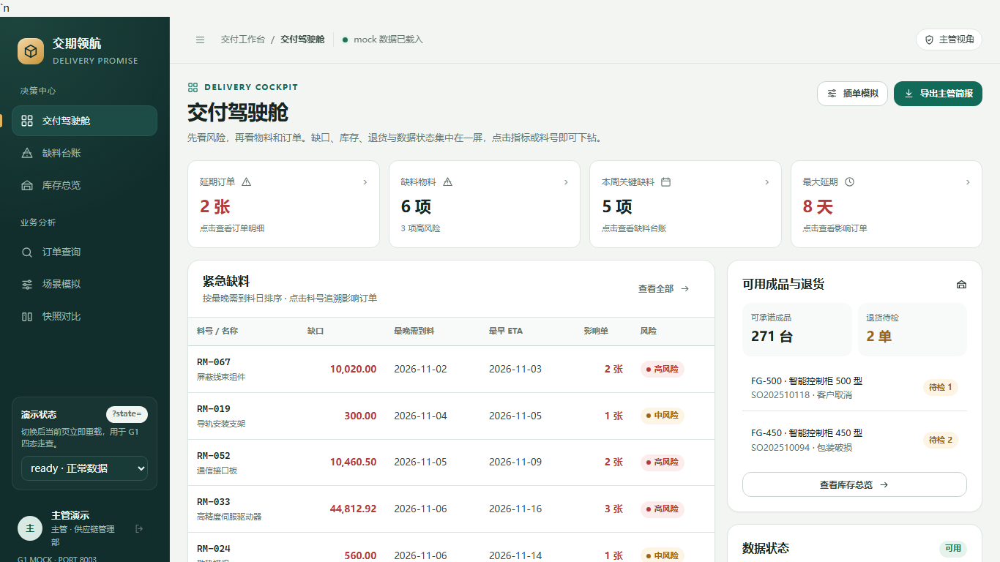
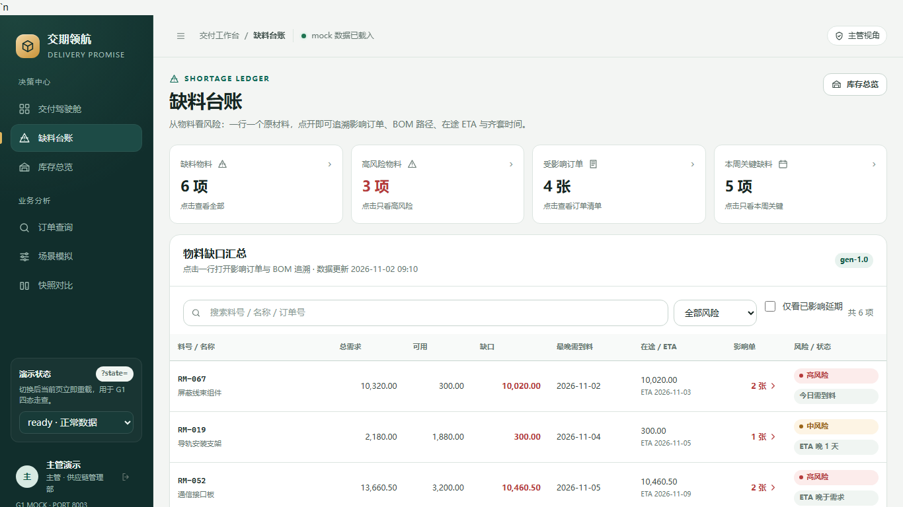
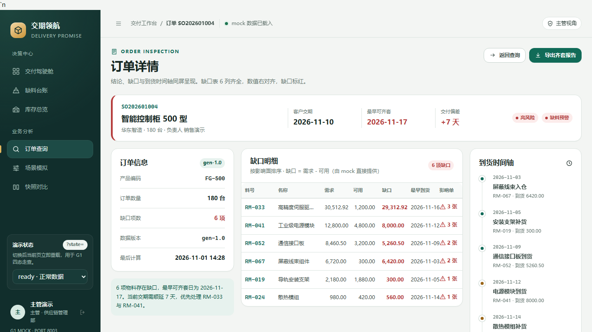
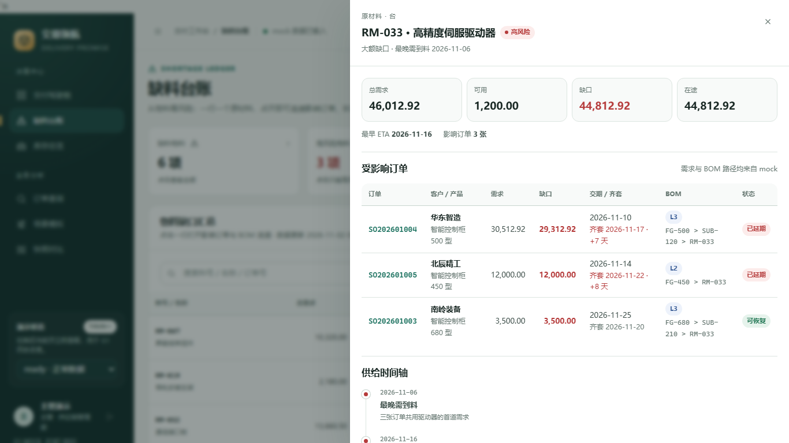
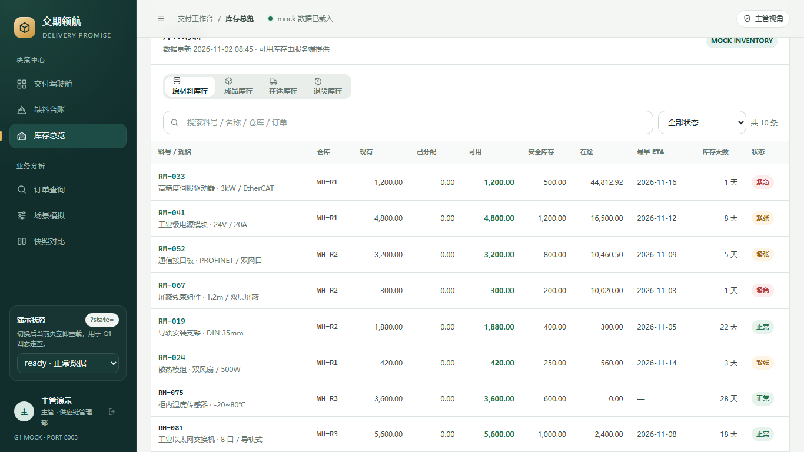
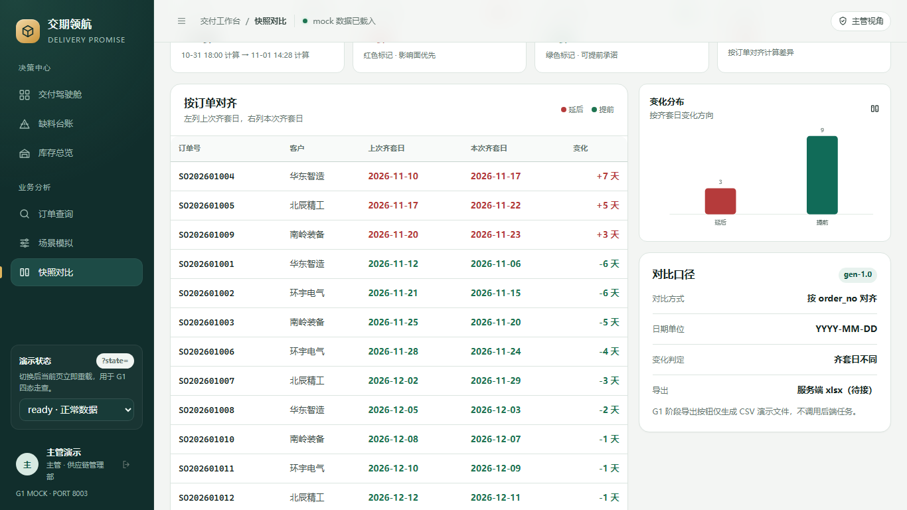
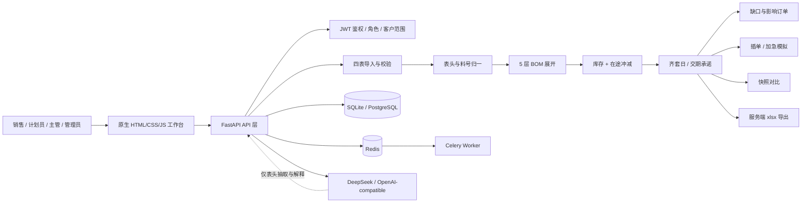
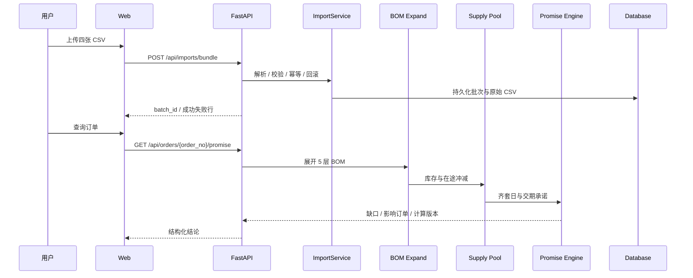

# 订单交期测算与缺料预警

> 面向离散制造场景的订单交期承诺、BOM 缺料展开、库存/在途冲减与场景模拟系统。

**作者：** Xxxnickname

<p align="center">
  
</p>

<p align="center">
  
  
  
  
  
</p>

## 项目概览

销售需要快速回答“这张单能不能按期交”，计划员需要把 ERP 四张表转成可计算的数据，主管需要先看到缺料和延期风险，再决定插单、顺延或催料。

本项目把这条链路拆成可复算的工程闭环：

```text
订单/BOM/库存/在途
        ↓
四表校验与别名归一
        ↓
BOM 递归展开 + 替代料/损耗
        ↓
库存扣分配 + 在途 ETA 冲减
        ↓
齐套日 / 最早开工日 / 交期承诺
        ↓
缺口明细 / 影响订单 / 场景模拟 / 快照对比 / 导出
```

核心约束：**模型不参与数量、日期、缺口和交期计算**。所有数字都由确定性 Python/Decimal 代码产生，LLM 只用于脏表头抽取和解释文案。

## 核心能力

- 四表 CSV 导入、模板下载、行列级错误定位
- 默认全或无导入，显式部分导入留痕
- 中文表头、料号、图号别名归一
- 5 层 BOM 展开、循环检测、超层报错、用量损耗
- 一对一替代料比例折算与替代不足回退
- 库存扣除已分配、在途按 ETA 顺序冲减
- 齐套日、最早开工日、交期承诺、延期天数
- 缺口按影响订单数排序，可追溯 BOM 路径
- 插单/加急模拟，结果不落库
- 快照生成与按订单号对齐对比
- 服务端 xlsx 导出、任务轮询与下载
- JWT 登录、角色依赖、客户范围与企业租户字段
- DeepSeek/OpenAI-compatible JSON 表头抽取，失败自动回退规则

## 界面预览

| 交付驾驶舱 | 缺料台账 |
|---|---|
|  |  |

| 订单详情 | 缺口追溯 |
|---|---|
|  |  |

| 库存总览 | 快照对比 |
|---|---|
|  |  |

更多界面：[完整截图集](docs/SCREENSHOTS.md)

## 系统架构



详细设计：[架构文档](docs/ARCHITECTURE.md) · [数据模型](docs/DATA_MODEL.md) · [API 文档](docs/API.md)

## 一次请求如何流转



## 技术栈

| 层次 | 技术 |
|---|---|
| 前端 | HTML5 / CSS / 原生 ES Module JavaScript |
| 图表 | 内联 SVG，零图表库依赖 |
| API | FastAPI / Pydantic / Uvicorn |
| 数据处理 | Pandas / Decimal / 标准库 `datetime` |
| 持久化 | SQLite（本地）/ PostgreSQL（容器） |
| 队列 | Redis / Celery（部署骨架） |
| 鉴权 | PBKDF2 密码哈希 / JWT |
| 模型 | DeepSeek / OpenAI-compatible Chat Completions |
| 测试 | Pytest / FastAPI TestClient / HTTPX MockTransport |

## 快速开始

```powershell
python -m venv .venv
.\.venv\Scripts\python.exe -m pip install -r requirements-dev.txt
.\.venv\Scripts\python.exe -m uvicorn app.main:app --host 127.0.0.1 --port 8003
```

打开：<http://127.0.0.1:8003/>

Docker：

```powershell
Copy-Item .env.example .env
docker compose up -d --build
```

工程名固定为 `plan`，应用端口固定为 `8003`。

## 验证

```powershell
.\.venv\Scripts\python.exe -m pytest -q
.\.venv\Scripts\python.exe scripts\acceptance.py
.\.venv\Scripts\python.exe eval\run.py --golden
.\.venv\Scripts\python.exe scripts\check_dod.py
```

当前结果：

- `pytest`：33 passed
- 极端/边界场景：22/22 PASS
- 20 单替身基准：100% 对齐
- 1000 行订单计算：低于 5 秒
- `/health`：200

测试说明：[测试与验收](docs/TESTING.md)

## 目录结构

```text
app/
  api/            FastAPI 路由：导入、订单、模拟、快照、导出、鉴权
  core/           配置、错误、数据库、JWT、Decimal、租户上下文
  models/         领域对象
  services/       解析、别名、BOM、供给、齐套、承诺、模拟、快照、导出
  workers/        Celery 入口占位
  static/         11 屏前端与 mock
samples/03/       四表样例、模板、错误样例、20 单替身基准
tests/            FR 编号测试
eval/             20 单基准对比
scripts/          自检、验收、DoD、LLM 检查
migrations/       PostgreSQL 初始表结构
docs/             架构、数据模型、截图、部署、LLM 说明
```

## 文档索引

- [架构设计](docs/ARCHITECTURE.md)
- [数据模型](docs/DATA_MODEL.md)
- [API 说明](docs/API.md)
- [截图集](docs/SCREENSHOTS.md)
- [测试与验收](docs/TESTING.md)
- [部署与运维](docs/operations.md)
- [服务器部署](docs/DEPLOYMENT.md)
- [DeepSeek API 传参](docs/llm-api.md)
- [当前边界与路线图](docs/LIMITATIONS.md)
- [安全策略](SECURITY.md)
- [GitHub 上传指南](docs/GITHUB_UPLOAD.md)
- [贡献指南](CONTRIBUTING.md)

## 当前边界

本项目是**可运行的工程化参考实现**，不是已经完成生产压测的商业 SaaS：

- 前端演示页面仍使用 `static/mock`，后端 API 已可独立调用。
- 本地默认 SQLite；Docker 目标数据库为 PostgreSQL，容器尚未在本机实际启动。
- Celery/Redis 队列骨架已建，正式高并发执行仍需部署环境验证。
- 20 单 golden 为 synthetic stand-in，真实人工核算数据到位后应替换。
- DeepSeek 已用 `deepseek-flash` 完成真实表头映射验证；生产费用和限流策略需按账号配置。

## License

[MIT](LICENSE)


