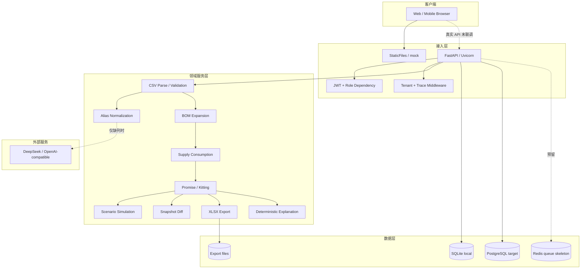
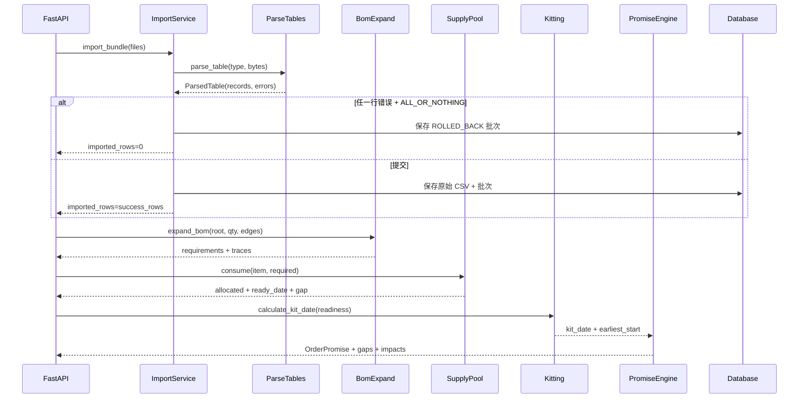
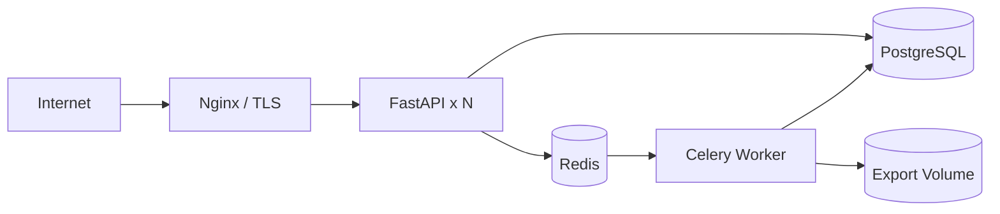

# 系统架构

## 1. 设计目标

系统把一个销售订单从 ERP 四张表转成可解释的交付承诺，设计目标：

- **可复算**：同一输入、同一版本、同一输出；
- **数字可追溯**：数量、日期、缺口均来自确定性代码；
- **导入可控**：默认全或无，异常行不静默丢弃；
- **BOM 有边界**：最多 5 层，循环立即报错；
- **角色可演示**：销售、计划、主管、管理员有不同菜单和页面；
- **故障可控**：LLM 失败回退规则，批次可回滚，导出任务可观测；
- **渐进落地**：先 CSV/API 闭环，再接 PostgreSQL、Redis/Celery 和真实前端。

## 2. 运行形态

项目当前有两个可独立运行的面：

| 面 | 入口 | 数据 | 说明 |
|---|---|---|---|
| 静态演示前端 | `app/static`，端口 8003 | `app/static/mock/*.json` | 11 屏、角色菜单、四态、移动端；不发真实业务请求 |
| 真实 FastAPI 后端 | `app.main:app`，端口 8003 | SQLite/PostgreSQL | 导入、BOM、供给、承诺、模拟、快照、导出 |

前端 `app/static/js/api.js` 中 `MOCK=true`。因此：

- 只启动 `python -m http.server` 可以完整看界面；
- 启动 `uvicorn` 后，`/` 仍然展示 mock 页面；
- 真实业务请调用 `/docs`、`/api/*` 或用 `curl`；
- 前端切真实 API 是后续路线图项，不是当前已完成能力。

## 3. 分层架构



## 4. 模块职责

| 模块 | 职责 | 不负责 |
|---|---|---|
| `app/api` | 参数解析、鉴权、统一响应、HTTP 状态 | 业务算法 |
| `app/core/config.py` | 环境变量、目录、端口、模型配置 | 页面逻辑 |
| `app/core/db.py` | SQLAlchemy 表、用户种子、批次/快照持久化 | BOM 计算 |
| `app/core/auth.py` | PBKDF2 密码哈希、JWT 签发/校验 | 角色菜单 |
| `app/core/tenant.py` | `tenant_id` / `trace_id` 上下文 | 身份认证 |
| `app/core/errors.py` | 统一错误码与响应结构 | 业务判断 |
| `app/services/parse_tables.py` | CSV 读取、表头归一、行列校验 | BOM 计算 |
| `app/services/alias.py` | 标准字段、料号归一；待确认队列为预留实现 | 替代料决策、持久化 CRUD |
| `app/services/bom_expand.py` | 递归展开、环检测、损耗、替代料计划 | 库存扣减 |
| `app/services/supply.py` | 在库/在途冲减、ETA 顺序消耗 | 交期顺延规则 |
| `app/services/kitting.py` | 齐套日、最早开工日 | 订单优先级 |
| `app/services/promise.py` | 订单优先级、缺口、影响清单 | 持久化 |
| `app/services/simulate.py` | 内存副本模拟插单/加急 | 写主表 |
| `app/services/snapshot.py` | 快照写入、按订单对齐比较 | 算法重算 |
| `app/services/export_service.py` | 线程池生成 xlsx、任务状态 | 业务计算 |
| `app/services/explain.py` | 确定性解释模板 | 调用模型 |
| `app/services/llm_client.py` | Bearer 调用 Chat Completions | 任何数字计算 |
| `app/services/llm_extract.py` | 规则优先的表头映射、模型建议白名单校验 | 解析业务数字 |
| `app/static` | 11 屏前端、mock、路由、交互 | 后端真实数据 |
| `app/workers` | Celery 入口与导出任务骨架 | 当前请求主链路 |

## 5. 计算主链路



## 6. 供给与承诺算法

### 6.1 供给池

```text
available[item] = on_hand - allocated
in_transit[item] = 按 eta_date ASC, batch_no ASC
```

订单按 `due_date ASC, order_no ASC` 处理。每个订单展开 BOM 后，按物料消耗共享供给池：

1. 先消耗当前可用库存；
2. 再按 ETA 顺序消耗在途；
3. 全部满足时，`ready_date = 最后一批消耗日期`；
4. 仍有剩余时，`gap_qty > 0`，不产生虚假齐套日；
5. 同一物料被多个订单共享时，先到期的订单优先。

### 6.2 BOM 展开

```text
qty_child = qty_parent × qty_per × (1 + scrap_rate)
```

- 根节点为成品，深度 0；
- 每条父子边深度 +1；
- 最大 5 层，超过抛 `BomDepthError`，不截断；
- 环路径立即抛 `BomCycleError`；
- 叶子物料按料号合并；
- 每条路径保留 `traces`，用于解释和追溯。

`level` 字段是导入时的 1–5 校验值；实际展开深度由 BOM 边结构决定。

### 6.3 齐套与承诺

- `kit_date`：所有物料 `ready_date` 的最大值；任一物料有缺口则为 `null`；
- `earliest_start_date`：`kit_date - PRODUCTION_LEAD_DAYS`，默认 3 天；
- `can_commit`：`kit_date is not null and kit_date <= due_date`；
- `delay_days`：`max(0, kit_date - due_date)`；有缺口时为 `null`。

> 当前 `can_commit` 只比较齐套日与客户交期，不把“最早开工日是否早于今天”作为额外门禁，这是明确口径。

### 6.4 替代料

`plan_substitutions()` 支持：

- 一对一替代；
- 替代比例折算；
- 替代料不足时返回剩余缺口。

当前状态：**服务与单测已实现，但订单承诺主链路未自动调用替代料计划**。BOM 展开只按 `qty_per` 和 `scrap_rate` 计算。生产接入前需要把替代组、替代料库存和审批策略串进计算链路。

## 7. 数据与持久化

### 7.1 当前运行时

- 本地默认 SQLite；生产目标 PostgreSQL；
- `import_batches_v2` 持久化原始 CSV（base64）与状态；
- `calc_snapshots_v2` 持久化订单承诺快照；
- `users` 保存 PBKDF2 密码哈希、角色、客户范围；
- `audit_logs_v2` 表结构已建，`audit()` 函数存在，但当前业务路径未调用；
- 四张业务表在运行时是解析后的内存对象，重启时从原始 CSV 重新解析。

### 7.2 目标规范化模型

`migrations/0001_init.py` 包含 `items`、`bom_edges`、`inventory`、`in_transit`、`orders`、`order_lines` 等目标表；这些是后续 PostgreSQL 迁移和查询优化的方向，不代表当前应用已经写入全部规范化表。

详见 [数据模型](DATA_MODEL.md)。

## 8. LLM 边界

LLM 只在以下场景使用：

- 规则无法识别表头时，`suggest_header_mapping()` 调用模型返回 `original_header -> canonical_column` 建议；
- 服务端对返回字段做白名单校验；
- 失败、超时、缺 Key 时自动回退规则映射。

LLM 不负责：

- 生成数量、缺口、日期；
- 直接改写 BOM；
- 直接决定订单承诺；
- 生成订单解释文案。

订单解释由 `explain.py` 的确定性模板生成，不调用模型，且文案中不出现具体数量/日期/天数，避免模型或模板篡改计算结果。详见 [LLM 说明](llm-api.md)。

## 9. 可靠性与错误处理

| 故障 | 当前处理 |
|---|---|
| CSV 非法 | 行号/列/原值/原因 |
| 任一表失败 | 默认整批回滚 |
| 部分导入 | 显式 `PARTIAL_WITH_AUDIT` + `allow_partial=true` |
| BOM 环 | 报错并返回路径 |
| 超过 5 层 | 报错，不截断 |
| 替代料不足 | 返回剩余缺口（独立服务） |
| LLM 超时 | 回退规则映射 |
| 重复导入 | 租户 + 模式 + SHA-256 幂等 |
| 应用重启 | 从 `import_batches_v2` 恢复批次，重新解析 CSV |
| 导出冲突 | 同一登录账号（未登录开发模式用 `X-User-Id`）同时只允许一个未完成任务，返回 429 |

## 10. 权限与租户现状

- 前端：菜单和路由按 `sales/planner/supervisor/admin` 控制；
- 后端：导入/模板/BOM 展开要求 `planner` 或 `admin`；其他接口在 `AUTH_REQUIRED=true` 时要求已登录；
- 客户范围：用户表有 `customer_scopes`，前端 mock 过滤；后端订单查询尚未强制过滤；
- 租户：请求头 `X-Tenant-Id` 参与上下文，但未与 JWT 身份强绑定；
- 生产前必须补：客户范围过滤、租户绑定、用户 CRUD、审计落库、细粒度角色。

## 11. 部署拓扑（目标）



- Compose 工程名：`plan`
- 应用端口：`8003`
- PostgreSQL/Redis 不映射宿主端口
- app/worker 通过环境变量注入数据库、Redis、模型密钥
- 生产必须设置 `AUTH_REQUIRED=true`

## 12. 关键取舍

| 决策 | 原因 |
|---|---|
| LLM 不算数 | 数字必须可复算、可对账 |
| CSV 而不是直连 ERP | 一期降低集成成本，先验证业务闭环 |
| 默认全或无 | 防止半批数据污染供给与承诺 |
| SQLite + PostgreSQL 双支持 | 本地低门槛，生产可迁移 |
| 线程导出 + Celery 骨架 | 当前零依赖可跑，生产可切换异步队列 |
| 前端零框架 | 11 屏可视化原型快速交付，降低构建复杂度 |
| 静态 mock 与后端分离 | 先评审交互和口径，再做真实联调 |