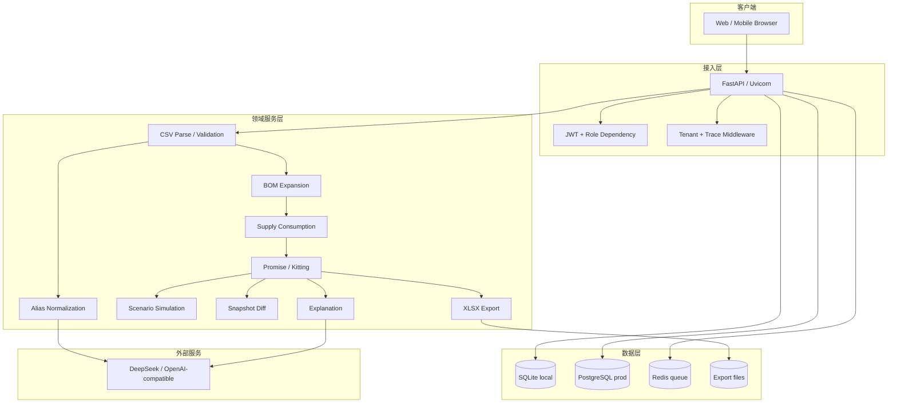
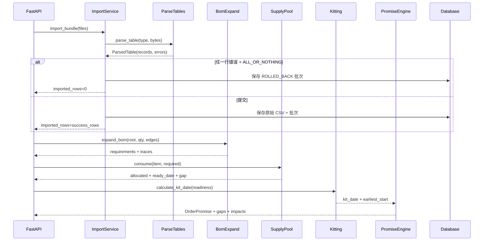
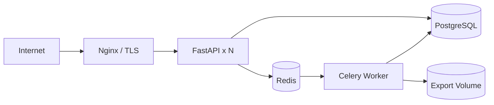

# 系统架构

## 1. 设计目标

系统把一个销售订单从 ERP 四张表转成可解释的交付承诺，必须满足：

- **可复算**：同一输入、同一版本、同一输出。
- **数字可追溯**：数量、日期、缺口均来自代码计算。
- **导入全或无**：异常行不静默丢弃。
- **BOM 有边界**：最多 5 层，循环立即报错。
- **角色隔离**：销售、计划、主管、管理员看到不同数据与操作。
- **故障可控**：LLM 失败回退规则；批次回滚；导出失败可观测。

## 2. 分层架构



## 3. 模块职责

| 模块 | 职责 | 不负责 |
|---|---|---|
| `app/api` | 参数解析、鉴权、统一响应、HTTP 状态 | 业务算法 |
| `app/core` | 配置、错误、数据库、JWT、Decimal、上下文 | 页面逻辑 |
| `app/services/parse_tables.py` | CSV 读取、表头归一、行列校验 | BOM 计算 |
| `app/services/alias.py` | 标准字段、料号归一、待确认队列 | 替代料决策 |
| `app/services/bom_expand.py` | 递归展开、环检测、损耗、替代料计划 | 库存扣减 |
| `app/services/supply.py` | 在库/在途冲减、ETA 顺序消耗 | 交期顺延规则 |
| `app/services/kitting.py` | 齐套日、最早开工日 | 订单优先级 |
| `app/services/promise.py` | 订单优先级、缺口、影响清单 | 持久化 |
| `app/services/simulate.py` | 内存副本模拟插单/加急 | 写主表 |
| `app/services/snapshot.py` | 快照写入、按订单对齐比较 | 算法重算 |
| `app/services/export_service.py` | 后台生成 xlsx、任务状态 | 业务计算 |
| `app/services/llm_client.py` | Authorization Bearer 调用模型 | 任何数字计算 |
| `app/static` | 11 屏前端、mock、路由、交互 | 业务口径 |

## 4. 计算主链路



## 5. 供给与承诺算法

### 5.1 供给池

```text
available[item] = on_hand - allocated
in_transit[item] = 按 eta_date 升序
```

订单按 `due_date ASC, order_no ASC` 处理。每个订单展开 BOM 后，按物料消耗共享供给池：

1. 先消耗当前可用库存；
2. 再按 ETA 顺序消耗在途；
3. 全部满足时，ready_date = 最后一批消耗日期；
4. 仍有剩余时，gap_qty > 0，且不产生虚假齐套日；
5. 同一物料被多个订单共享时，先到期的订单优先。

### 5.2 BOM 展开

```text
qty_child = qty_parent × qty_per × (1 + scrap_rate)
```

- Root 为成品，深度 0；
- 每个父子边深度 +1；
- 允许最大 5 层；
- 环路径立即抛出 `BomCycleError`；
- 叶子物料按料号合并；
- 每条路径单独保留，解释时可追溯。

## 6. 数据与持久化

- 本地默认 SQLite，便于零依赖运行；
- Docker 环境使用 PostgreSQL；
- `import_batches_v2` 持久化原始 CSV（base64）与状态；
- `calc_snapshots_v2` 持久化订单承诺快照；
- `users` 保存 PBKDF2 密码哈希；
- `audit_logs_v2` 预留关键动作审计。

详见 [数据模型](DATA_MODEL.md)。

## 7. LLM 边界

LLM 仅用于：

- 规则无法识别的表头映射建议；
- 基于结构化中间量的解释文案。

不允许：

- 生成数量、缺口、日期；
- 直接改写 BOM；
- 直接决定订单承诺。

DeepSeek Key 只从后端环境读取，通过 `Authorization: Bearer` 传递，失败自动回退规则。详见 [LLM 说明](llm-api.md)。

## 8. 可靠性设计

| 故障 | 当前处理 |
|---|---|
| CSV 非法 | 行号/列/原值/原因 |
| 任一表失败 | 默认整批回滚 |
| 部分导入 | 显式确认后保留成功行 |
| BOM 环 | 报错并返回路径 |
| 超过 5 层 | 报错，不截断 |
| 替代料不足 | 返回剩余缺口 |
| LLM 超时 | 回退规则映射 |
| 重复导入 | 租户 + 模式 + SHA-256 幂等 |
| 应用重启 | SQLite 恢复批次与快照（本地验证） |

## 9. 部署拓扑（目标）



- Compose 工程名：`plan`
- 应用端口：`8003`
- PostgreSQL/Redis 不映射宿主端口
- app/worker 通过环境变量注入数据库、Redis、模型密钥
- 生产必须设置 `AUTH_REQUIRED=true`

## 10. 关键取舍

| 决策 | 原因 |
|---|---|
| LLM 不算数 | 数字必须可复算、可对账 |
| CSV 而不是直连 ERP | 一期降低集成成本，先验证业务闭环 |
| 默认全或无 | 防止半批数据污染供给与承诺 |
| SQLite + PostgreSQL 双支持 | 本地低门槛，生产可迁移 |
| 线程导出 + Celery 骨架 | 当前零依赖可跑，生产可切换异步队列 |
| 前端零框架 | 11 屏可视化原型快速交付，降低构建复杂度 |
