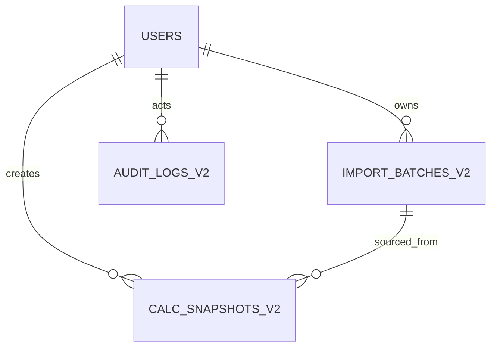
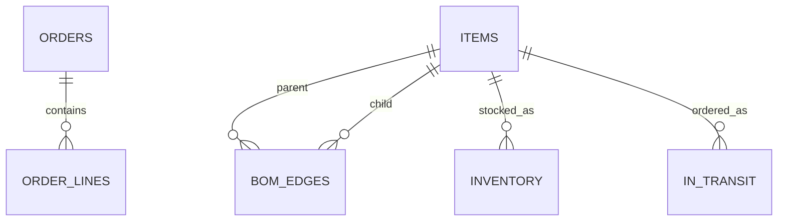

# 数据模型

## 1. 先分清两层模型

本项目同时存在两层数据模型：

| 层 | 位置 | 当前是否写入 | 用途 |
|---|---|---|---|
| 运行时持久化模型 | `app/core/db.py` | 是 | 用户、导入批次、快照、审计表 |
| 目标规范化模型 | `migrations/0001_init.py` | 迁移脚本已准备，当前应用未全部写入 | PostgreSQL 生产化、查询优化、后续主数据治理 |
| 内存领域模型 | `app/models/domain.py` | 每次请求/计算时生成 | 订单、BOM、库存、在途、承诺、缺口 |

理解这一点很重要：当前订单/BOM/库存/在途不是分别写入 `orders`、`bom_edges`、`inventory`、`in_transit` 表，而是解析成内存对象，原始 CSV 以 base64 存在导入批次里。

## 2. 当前运行时持久化表

### 2.1 `users`

| 字段 | 类型 | 说明 |
|---|---|---|
| `id` | Integer PK | 自增主键 |
| `tenant_id` | String(64) | 租户，默认 `demo` |
| `account` | String(64) | 登录账号 |
| `name` | String(100) | 姓名/显示名 |
| `role` | String(20) | `sales/planner/supervisor/admin` |
| `department` | String(100) | 部门 |
| `status` | String(20) | `启用/停用` |
| `password_hash` | String(256) | PBKDF2-HMAC-SHA256，26 万次迭代 |
| `customer_scopes` | JSON | 客户范围列表 |
| `created_at` | DateTime | 创建时间 |

唯一约束：`(tenant_id, account)`。

### 2.2 `import_batches_v2`

| 字段 | 类型 | 说明 |
|---|---|---|
| `id` | Integer PK | 自增主键 |
| `tenant_id` | String(64) | 租户 |
| `batch_id` | String(100) | 业务批次号 |
| `file_hash` | String(64) | 四表内容 SHA-256 |
| `mode` | String(40) | `ALL_OR_NOTHING` / `PARTIAL_WITH_AUDIT` |
| `status` | String(40) | `COMMITTED` / `ROLLED_BACK` / `PARTIAL_IMPORTED` |
| `created_at` | DateTime | 创建时间 |
| `payload` | JSON | `{files: {orders: base64, bom: base64, ...}}` |

唯一约束：`(tenant_id, batch_id)`。

保留原始 CSV 的原因：重启后重新解析 Decimal/date，避免 JSON 序列化丢失精度和类型。

### 2.3 `calc_snapshots_v2`

| 字段 | 类型 | 说明 |
|---|---|---|
| `id` | Integer PK | 自增主键 |
| `tenant_id` | String(64) | 租户 |
| `snapshot_id` | String(100) | 快照 ID |
| `calc_version` | String(64) | 计算版本 |
| `created_at` | DateTime | 创建时间 |
| `items` | JSON | 订单承诺字典列表 |

唯一约束：`(tenant_id, snapshot_id)`。快照不通过外键关联订单，而是按 `order_no` 在 JSON 内对齐。

### 2.4 `audit_logs_v2`

| 字段 | 类型 | 说明 |
|---|---|---|
| `id` | Integer PK | 自增主键 |
| `tenant_id` | String(64) | 租户 |
| `actor` | String(64) | 操作人 |
| `action` | String(64) | 动作 |
| `target` | String(200) | 目标对象 |
| `detail` | JSON | 结构化细节 |
| `trace_id` | String(64) | 链路 ID |
| `created_at` | DateTime | 时间 |

当前状态：表结构和 `audit()` 函数已存在，但业务路径尚未调用，不能视为“审计已落库”。

## 3. 内存领域模型

解析后的记录使用强类型对象，主要在 `app/models/domain.py`：

### 3.1 订单 `OrderRecord`

| 字段 | 类型 | 说明 |
|---|---|---|
| `order_no` | str | 订单号 |
| `item_code` | str | 成品料号 |
| `qty` | Decimal | 订单数量 |
| `due_date` | date | 客户交期 |
| `customer` | str | 客户 |

### 3.2 BOM 边 `BomEdge`

| 字段 | 类型 | 说明 |
|---|---|---|
| `parent_code` | str | 父件 |
| `child_code` | str | 子件 |
| `qty_per` | Decimal | 单位用量 |
| `scrap_rate` | Decimal | 损耗率，例如 `0.02` |
| `substitute_group` | str/null | 替代组 |
| `level` | int/null | 导入时的 1–5 校验值 |

### 3.3 库存 `InventoryRecord`

| 字段 | 类型 | 说明 |
|---|---|---|
| `item_code` | str | 物料 |
| `on_hand` | Decimal | 现有库存 |
| `allocated` | Decimal | 已分配 |
| `warehouse` | str | 仓库/库位 |

可用量：`available = on_hand - allocated`。

### 3.4 在途 `InTransitRecord`

| 字段 | 类型 | 说明 |
|---|---|---|
| `item_code` | str | 物料 |
| `qty` | Decimal | 在途数量 |
| `eta_date` | date | 预计到货日 |
| `batch_no` | str | 批次号 |
| `supplier` | str | 供应商 |

### 3.5 承诺 `OrderPromise`

| 字段 | 类型 | 说明 |
|---|---|---|
| `order_no` | str | 订单号 |
| `customer` | str | 客户 |
| `item_code` | str | 成品 |
| `qty` | Decimal | 数量 |
| `due_date` | date | 客户交期 |
| `kit_date` | date/null | 齐套日；有缺口时为 null |
| `earliest_start_date` | date/null | 齐套日减生产提前期 |
| `can_commit` | bool | `kit_date <= due_date` |
| `delay_days` | int/null | 齐套日超期天数；有缺口时为 null |
| `gaps` | list | 缺口行，含影响订单 |
| `calc_version` | str | 计算版本 |

### 3.6 缺口 `GapLine`

| 字段 | 类型 | 说明 |
|---|---|---|
| `item_code` | str | 物料 |
| `item_name` | str | 名称（当前等于料号） |
| `need` | Decimal | 展开后总需求 |
| `available` | Decimal | 实际分配量 |
| `gap` | Decimal | 未覆盖数量 |
| `ready_date` | date/null | 该物料齐套日 |
| `impact_orders` | list[str] | 同样缺该物料的订单号 |

## 4. 目标规范化模型（迁移脚本）

`migrations/0001_init.py` 中定义了以下目标表，供后续 PostgreSQL 生产化使用：

### 4.1 主数据

- `items`：物料主数据，成品/半成品/原材料；
- `bom_edges`：父子边、用量、损耗、替代组、层级；
- `inventory`：库存、已分配、仓库；
- `in_transit`：在途数量、ETA、批次、供应商。

### 4.2 订单

- `orders`：订单头；
- `order_lines`：订单行。

### 4.3 计算与批次

- `calc_snapshots`：旧版快照目标表；
- `import_batches`：旧版批次目标表；
- `audit_logs`：旧版审计目标表；
- `import_batches_v2`、`calc_snapshots_v2`、`audit_logs_v2`：当前运行时使用的版本。

> 迁移脚本包含这些表，不代表应用已经写入全部表。当前应用实际使用的是 `users` + `*_v2` 表 + 原始 CSV payload。

## 5. 关系图

当前运行时关系是“用户/批次/快照/审计 + JSON payload”，不是强外键关系：

目标规范化关系是：

## 6. 字段精度

| 类型 | 精度/规则 |
|---|---|
| 数量 | `Decimal(18,6)`，计算时使用 Python Decimal |
| 金额 | `Decimal(18,4)`（预留） |
| BOM 中间量 | 按 Decimal 计算，输出保留 6 位小数 |
| 舍入 | `ROUND_HALF_UP` |
| 日期 | 严格 `YYYY-MM-DD`，不做自动猜测 |
| 百分比 | 以小数表达，`0.02` 表示 2% |

## 7. 生命周期

1. 请求上传四张 CSV；
2. `parse_table()` 解析、归一、校验；
3. 全或无失败：保存 `ROLLED_BACK` 批次，`imported_rows=0`；
4. 成功/部分导入：保存原始 CSV 到 `import_batches_v2.payload`；
5. 计算时从批次记录构造内存对象；
6. 计算快照写入 `calc_snapshots_v2.items`；
7. 应用重启：从 `import_batches_v2` 恢复批次并重新解析；
8. 没有已提交批次时，启动脚本从 `samples/03` 自动导入演示数据。

## 8. 生产化建议

- 为 `tenant_id`、`batch_id`、`file_hash` 增加组合索引；
- 把 `orders`、`order_lines`、`bom_edges`、`inventory`、`in_transit` 从目标表真正落库；
- 为 `audit_logs_v2` 接入导入、查询、导出、权限变更写入；
- 将 `X-Tenant-Id` 与 JWT 的 `tenant_id` 强绑定；
- 为客户范围查询增加数据库级过滤；
- 对原始 CSV payload 做保留期限和脱敏策略；
- 对大批量 BOM 展开增加缓存/预计算。