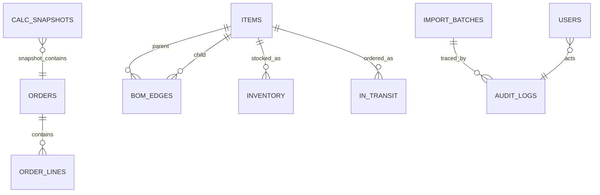

# 数据模型

## 1. 领域关系

## 2. 关键表

### `items`

物料主数据：成品、半成品、原材料；支持料号、类型、单位和 BOM 层级。

### `bom_edges`

BOM 父子边：

- `parent_code → child_code`
- `qty_per`：单位用量，`NUMERIC(18,6)`
- `scrap_rate`：损耗率，小数表达，例如 0.02
- `substitute_group`：一对一替代组
- `level`：1–5

### `inventory`

库存：

- `on_hand`：现有库存
- `allocated`：已分配
- `available = on_hand - allocated`
- `warehouse`：仓库

### `in_transit`

在途：

- `qty`
- `eta_date`
- `batch_no`
- `supplier`

供给冲减时按 `eta_date ASC` 排序。

### `orders / order_lines`

订单与订单行。订单优先级使用 `due_date ASC, order_no ASC`。

### `import_batches_v2`

持久化导入批次：

- `file_hash`
- `mode`
- `status`
- `payload`：原始 CSV 的 base64
- `created_at`

保留原始 CSV 的原因是重启后可重新解析 Decimal/date，避免 JSON 丢精度。

### `calc_snapshots_v2`

计算快照：

- `snapshot_id`
- `calc_version`
- `items`：订单承诺字典列表
- `created_at`

### `users`

- PBKDF2 密码哈希
- 角色
- 客户范围
- 状态

### `audit_logs_v2`

关键动作审计：导入、查询、导出、权限变更，保留 `actor`、`action`、`target`、`trace_id`。

## 3. 字段精度

| 类型 | 精度 |
|---|---|
| 数量 | `Decimal(18,6)` |
| 金额 | `Decimal(18,4)` |
| 中间 BOM 量 | 3 位小数参与对账 |
| 后端口径 | `ROUND_HALF_UP` |

## 4. 当前实现说明

- 本地默认 SQLite，表名与新模型一致；
- PostgreSQL 目标迁移见 `migrations/0001_init.py`；
- 生产环境建议为 `tenant_id`、`batch_id`、`file_hash` 增加组合索引并进行慢查询监控。
