# 界面截图

截图来自 1366×768 桌面视口与 375px 移动视口，用于展示 11 屏工作台的主要交互与状态。图片位于 `docs/screenshots/`。

> 重要：截图展示的是 `static/mock` 演示数据，不是后端真实导入结果。真实 API 已可独立调用，但前端尚未完成真实数据联调。

## 1. 登录与角色入口

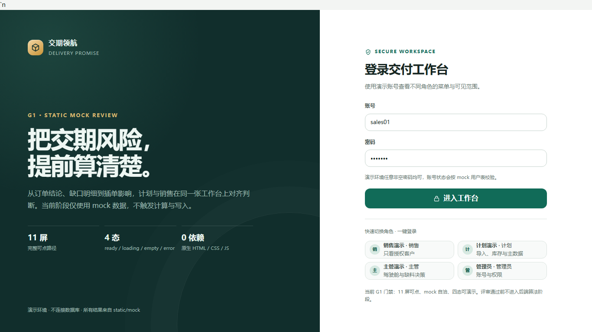

- 四个演示角色：销售、计划、主管、管理员；
- 快速切换角色；
- 静态 mock 密码任意非空。

## 2. 主管交付驾驶舱

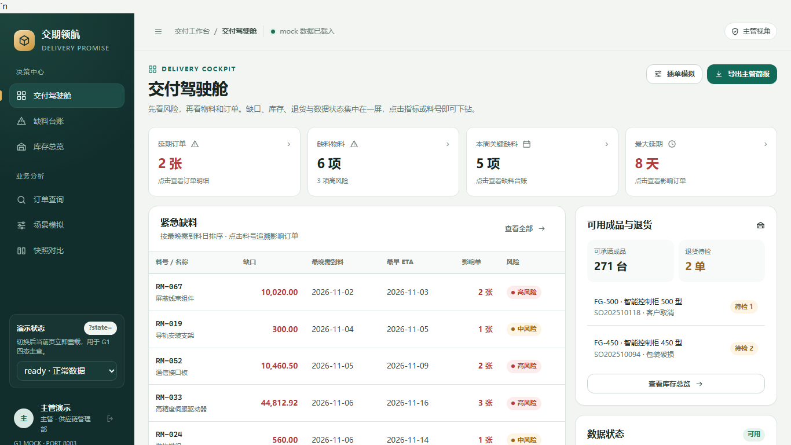

- 延期订单、缺料汇总、本周关键缺料；
- 指标卡可下钻到订单/缺料；
- 数据来自 mock。

## 3. 订单查询

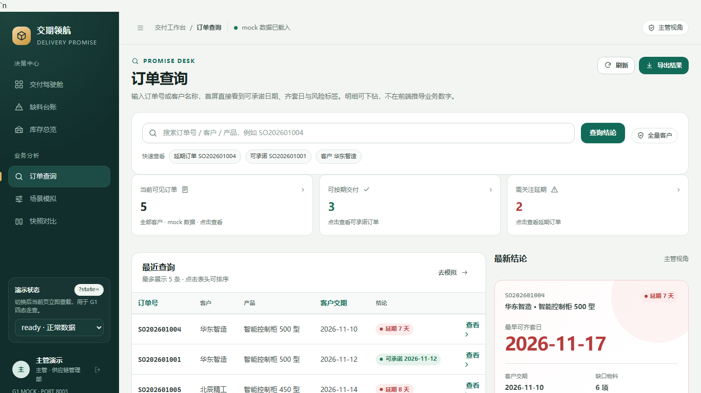

- 销售只看授权客户；计划/主管/管理员看全量；
- 支持订单号/客户/成品搜索；
- 可跳转订单详情。

## 4. 订单详情

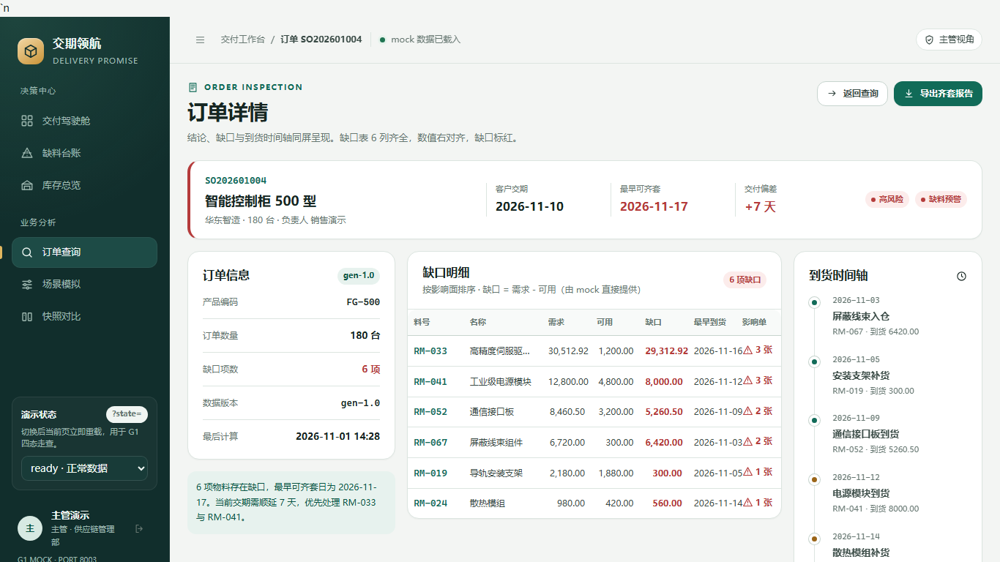

- 承诺结论、齐套日、最早开工日、延期天数；
- 缺口表和影响订单；
- 数据来自 mock。

## 5. 缺料台账

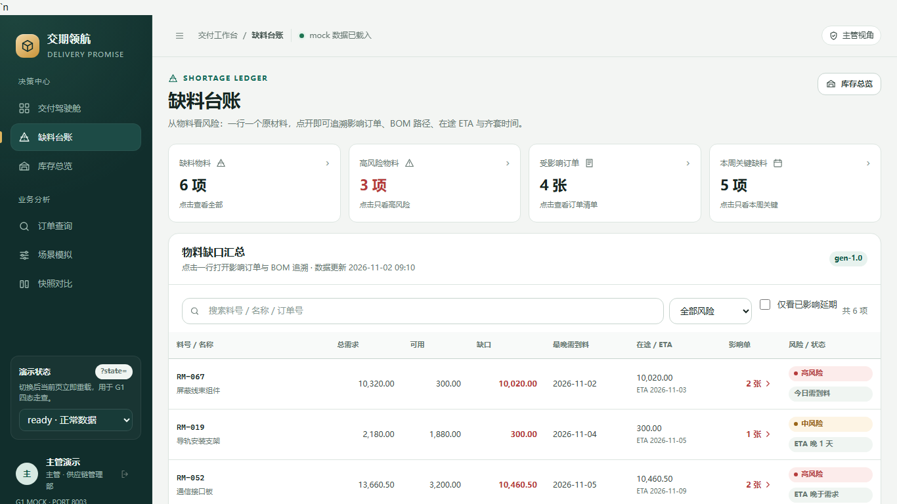

- 按物料汇总总需求、可用、缺口、最早需到料、在途 ETA、影响订单；
- 支持风险筛选和搜索。

## 6. 缺口追溯抽屉

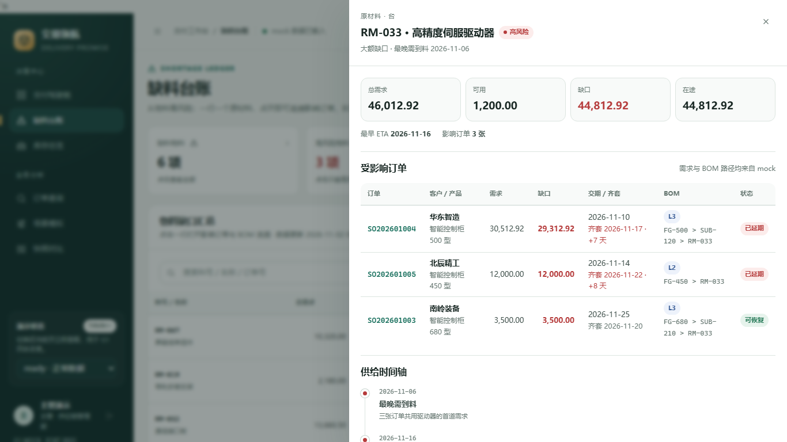

- 受影响订单；
- BOM 路径；
- 在途 ETA；
- 供给时间轴。

> 当前为 mock 交互；真实数据可从订单承诺 `gaps`/`impact_orders` 聚合。

## 7. 库存总览

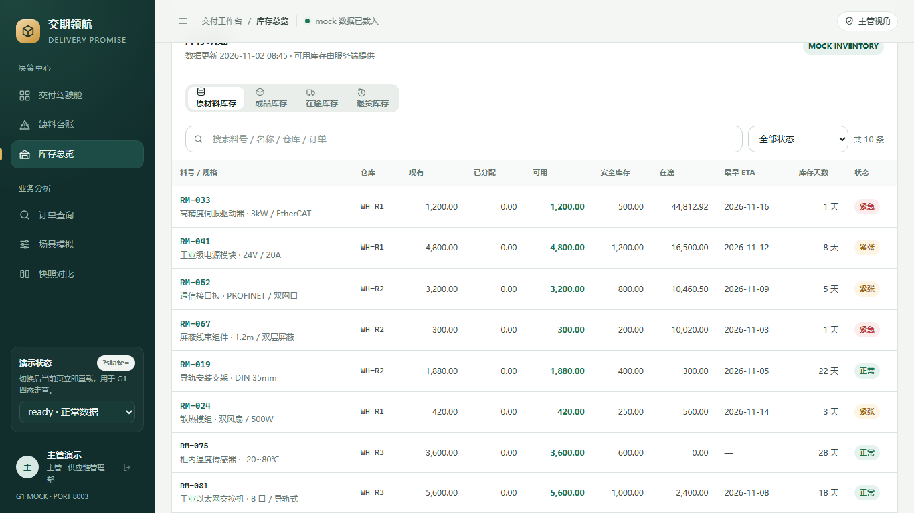

- 原材料/成品库存展示；
- 库存与在途口径；
- 当前为 mock。

## 8. 退货库存

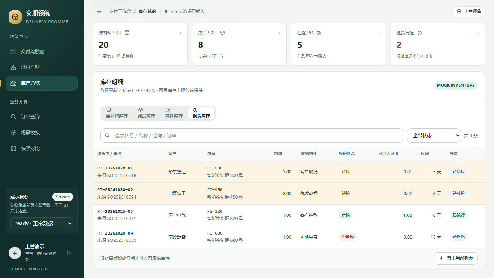

- 待检退货不计入可承诺库存；
- 当前为 mock 展示，后端尚未建模退货表。

## 9. 场景模拟

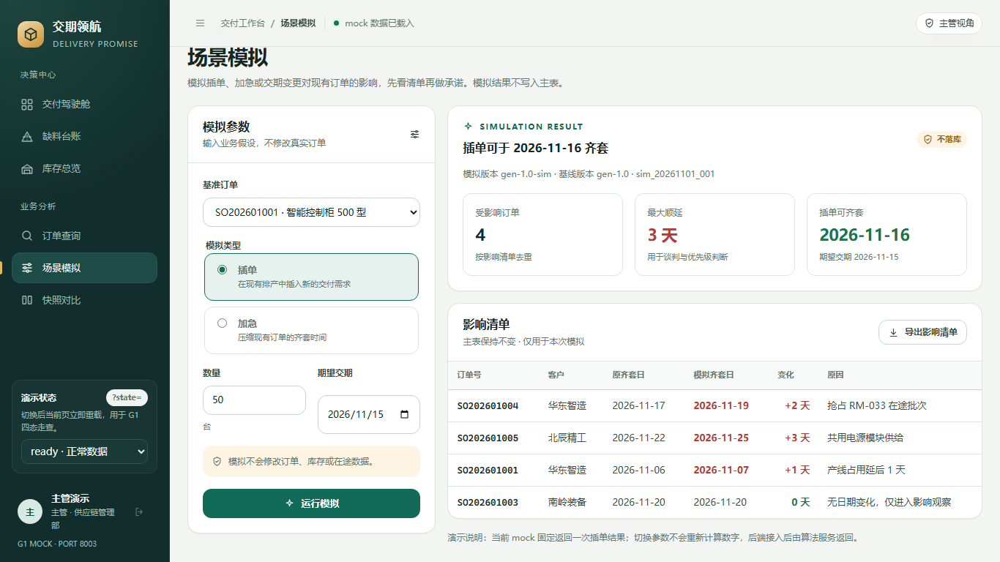

- 插单/加急；
- 影响订单和交期变化；
- 当前为 mock；后端 `POST /api/simulate` 已实现。

## 10. 快照对比

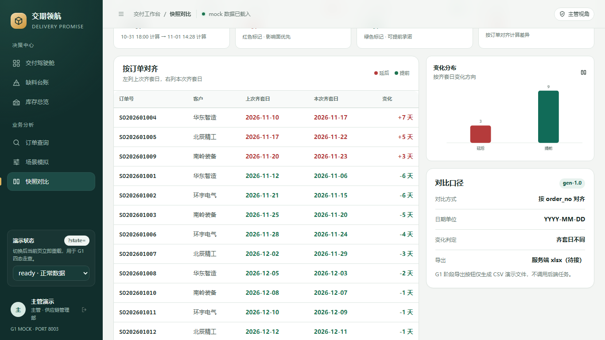

- 延后标红，提前标绿；
- 按订单号对齐；
- 当前为 mock；后端快照 API 已实现。

## 11. 订单指标下钻

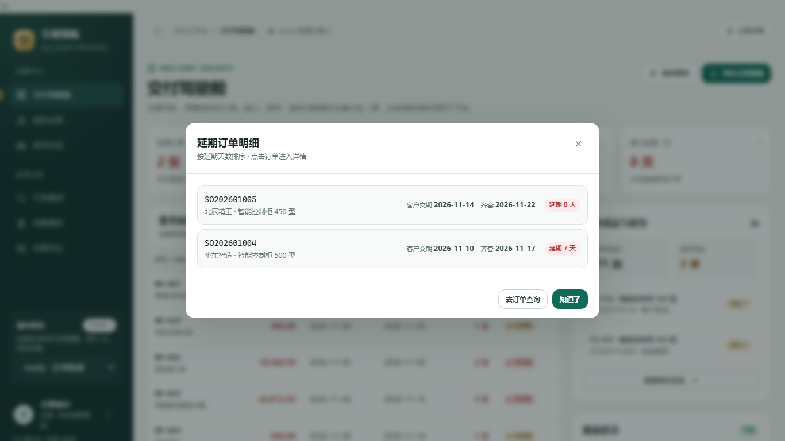

- 从驾驶舱指标跳到订单清单；
- 支持下钻到订单详情。

## 12. 移动端订单查询

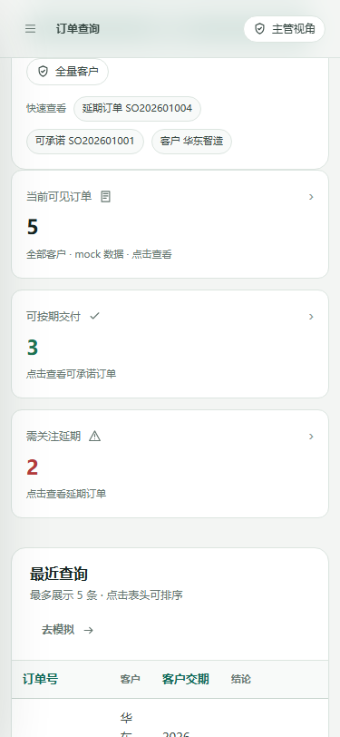

- 375px 视口；
- 侧边栏抽屉、卡片化列表；
- 适合销售在手机上查看订单状态。